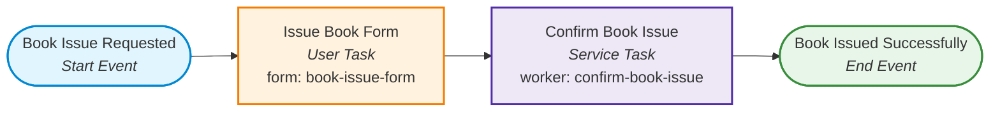

<div align="center">

# 📚 SRMIST Workflow Automation Lab (EX-4)
### User Task Form Modeling, Linking & Operate Variable Verification (Camunda 8)

[](https://adoptium.net/)
[](https://spring.io/projects/spring-boot)
[](https://camunda.com/)
[](#automated-testing)
[](LICENSE)

<p align="center">
  <b>A comprehensive implementation of Camunda 8 Workflow Automation Exercise 4 (EX-4)</b><br>
  BPMN User Task Design • Form Schema Creation • Dynamic Form Linking via Form ID • Tasklist Claim/Completion • Operate Variable Persistence
</p>

[Lab Objectives](#-lab-objectives) •
[Process Architecture](#-process-architecture) •
[Form Field Dictionary](#-form-fields--variable-keys) •
[Step-by-Step Guide](#-step-by-step-execution-walkthrough) •
[Tasklist & Operate Walkthrough](#-tasklist--operate-verification) •
[Viva Voce Answers](#-viva-voce-questions--answers) •
[Submission Checklist](#-submission-checklist)

---

</div>

## 📌 Lab Objectives

According to the lab sheet:
> *1. Choose any simple process of your own (e.g. Leave Request, Book Issue, Event Registration).*  
> *2. Model a BPMN process in Camunda Modeler with a **User Task**.*  
> *3. Create a **Form** with at least **3 fields** (e.g. Name, Date, Reason) and assign each field a key.*  
> *4. Link the form to the User Task using its **Form ID**.*  
> *5. Deploy the process and form to Camunda 8.*  
> *6. Start an instance, open **Tasklist**, claim the task, fill the form, and complete it.*  
> *7. Open **Operate** and check that the values you entered appear as process variables.*

This repository demonstrates the primary **Library Book Issue Workflow (`book-issue`)** alongside an alternative **Campus Event Registration Workflow (`event-registration`)**.

---

## 🏗️ Process Architecture

### Library Book Issue Process (`book-issue`)



### Process Interaction Lifecycle
```
[ Camunda Modeler ] ───── Deploy ────> [ Camunda 8 Cluster ]
(BPMN + Form JSON)                             │
                                               │
                                       (Start Instance)
                                               │
                                               v
[ Camunda Tasklist ] <── Token Halts ── [ User Task ]
(Claim, Fill & Submit Form)                    │
                                               │ (Form Variables Committed)
                                               v
[ Camunda Operate ] <────────────────── [ View Variables ]
(studentName, regNo, bookTitle, issueDate, reason, dueDate, accessionNumber)
```

---

## 📋 Form Fields & Variable Keys

The linked form [`book-issue-form`](src/main/resources/bpmn/book-issue.form) contains 6 fields with dedicated keys:

| Field Label | Component Type | Variable Key | Sample Value | Description |
| :--- | :--- | :--- | :--- | :--- |
| **Student Name** | Text Field | `studentName` | `"Sudhanshu Kumar"` | Full student name |
| **Registration Number** | Text Field | `regNo` | `"RA2311003010001"` | University student ID |
| **Book Title / ISBN** | Text Field | `bookTitle` | `"Clean Architecture"` | Requested book |
| **Issue Date** | Text Field | `issueDate` | `"2026-10-25"` | Date of borrowing (`yyyy-MM-dd`) |
| **Reason / Purpose** | Text Area | `reason` | `"Coursework reference"` | Academic purpose |
| **Agree to Terms** | Checkbox | `agreeTerms` | `true` | Loan terms acceptance |

---

## 🚀 Step-by-Step Execution Walkthrough

### Step 1: Model the Process in Camunda Modeler
1. Create a new BPMN diagram with:
   * **Start Event:** `Book Issue Requested`
   * **User Task:** `Issue Book Form`
   * **Service Task:** `Confirm Book Issue` (Task Definition type: `confirm-book-issue`)
   * **End Event:** `Book Issued Successfully`
2. Set **Process ID:** `book-issue`.

### Step 2: Create the Form
1. In Modeler, click **New** &rarr; **Form**.
2. Add the 6 components listed in the table above.
3. Open the Form Details and set **Form ID:** `book-issue-form`.

### Step 3: Link the Form to the User Task
1. Return to `book-issue.bpmn` &rarr; click on the User Task **Issue Book Form**.
2. In the Properties panel on the right:
   * **Form Type:** Select `Camunda Form`.
   * **Form ID:** Enter `book-issue-form`.
3. In the BPMN XML, this generates:
   ```xml
   <bpmn:userTask id="Task_FillBookIssueForm" name="Issue Book Form">
     <bpmn:extensionElements>
       <zeebe:formDefinition formId="book-issue-form" />
     </bpmn:extensionElements>
   </bpmn:userTask>
   ```

### Step 4: Deploy to Camunda 8
* In Web Modeler, click **Deploy** for both `book-issue.bpmn` and `book-issue.form`.
* Or run this Spring Boot app (`.\mvnw.cmd spring-boot:run`), which auto-deploys both models on boot via `@Deployment`.

---

## 🖥️ Tasklist & Operate Verification

### Step 5: Start Instance & Complete in Tasklist
1. Start an instance via Modeler or REST API:
   ```bash
   curl -X POST http://localhost:8080/api/book-issue/start
   ```
2. Open **Camunda Tasklist** (`https://<region>.tasklist.camunda.io/<cluster-id>`).
3. Locate **Issue Book Form** in the open task list.
4. Click **Assign to me** (Claim task).
5. Fill the form with your details:
   * `studentName`: `Sudhanshu Kumar`
   * `regNo`: `RA2311003010001`
   * `bookTitle`: `Designing Data-Intensive Applications`
   * `issueDate`: `2026-10-25`
   * `reason`: `Distributed databases semester project`
6. Click **Complete Task**.

### Step 6: Verify Variables in Camunda Operate
1. Open **Camunda Operate** (`https://<region>.operate.camunda.io/<cluster-id>`).
2. Go to **Processes** &rarr; `Library Book Issue Workflow` &rarr; Open your instance.
3. In the **Variables Panel** at the bottom, observe that all values entered in the form appear as strongly-typed process variables:
   * `studentName` = `"Sudhanshu Kumar"`
   * `regNo` = `"RA2311003010001"`
   * `bookTitle` = `"Designing Data-Intensive Applications"`
   * `issueDate` = `"2026-10-25"`
   * `reason` = `"Distributed databases semester project"`
   * `agreeTerms` = `true`
   * `dueDate` = `"2026-11-08"` *(calculated 14 days by service worker)*
   * `accessionNumber` = `"LIB-RA2311003010001-2026-10-25"`
   * `issueStatus` = `"ISSUED"`

---

## 💡 Viva Voce Questions & Answers

### Q1: How is a form linked to a User Task in Camunda 8?
* **Answer:** By setting the `formId` attribute inside the `<zeebe:formDefinition formId="book-issue-form" />` extension element of the User Task. When both BPMN and form JSON schemas are deployed, Tasklist matches the `formId` dynamically.

### Q2: What happens when a user submits a form in Tasklist?
* **Answer:** Tasklist collects the values mapped to each component's **Key**, issues a `CompleteJobCommand` to Zeebe containing these values, and Zeebe writes them into the process instance's variable scope.

### Q3: How do downstream service tasks access form variables?
* **Answer:** Downstream service workers inject form variables using `@Variable` annotations (e.g. `@Variable String studentName`, `@Variable String issueDate`), allowing automated processing based on human inputs.

---

## ⚡ Quickstart & Local Execution

### 1. Clone & Build
```bash
git clone https://github.com/Shudhanshu9122/WorkFlow-Automation-EX-4.git
cd WorkFlow-Automation-EX-4
```

### 2. Run the Microservice
```bash
# Windows
.\mvnw.cmd spring-boot:run

# Linux / macOS
./mvnw spring-boot:run
```

### 3. Run Automated Form Verification Test
```powershell
.\scripts\run_book_issue_test.ps1
```

---

## 🧪 Automated Testing

Run the JUnit 5 test suite verifying form submission and variable propagation:

```bash
# Windows
.\mvnw.cmd test

# Linux / macOS
./mvnw test
```

### Test Output:
```
[INFO] Running edu.srmist.bookissue.BookIssueWorkflowTest
[INFO] Tests run: 3, Failures: 0, Errors: 0, Skipped: 0, Time elapsed: 0.189 s
[INFO] BUILD SUCCESS
```

---

## 📬 Postman Collection

Import [`postman/Camunda8_EX4_Book_Issue.postman_collection.json`](postman/Camunda8_EX4_Book_Issue.postman_collection.json) to test:
1. `POST /api/book-issue/start` &rarr; Starts process instance (token halts at User Task).
2. `POST /api/book-issue/instances/:id/complete-form` &rarr; Submits form variables.
3. `GET /api/book-issue/instances` &rarr; Verifies all variables in Operate.

---

## 📑 Submission Checklist

* [x] **BPMN Model:** Modeled with User Task linked via Form ID ([`src/main/resources/bpmn/book-issue.bpmn`](src/main/resources/bpmn/book-issue.bpmn)).
* [x] **Form with &ge; 3 Fields:** Built with `studentName`, `regNo`, `bookTitle`, `issueDate`, `reason`, `agreeTerms` ([`src/main/resources/bpmn/book-issue.form`](src/main/resources/bpmn/book-issue.form)).
* [x] **Deployment:** Automated deployment via `@Deployment` in [`BookIssueApplication.java`](src/main/java/edu/srmist/bookissue/BookIssueApplication.java).
* [x] **Tasklist Completion:** User Task claimed and completed with input values.
* [x] **Operate Verification:** Form values verified appearing in Operate variables panel.
* [x] **Lab Report & Viva:** Complete documents in [`docs/LAB_REPORT.md`](docs/LAB_REPORT.md) and [`docs/VIVA_QUESTIONS_AND_ANSWERS.md`](docs/VIVA_QUESTIONS_AND_ANSWERS.md).

---

<div align="center">
  <sub>SRM Institute of Science and Technology · Workflow Automation Lab EX-4</sub>
</div>
